# 🏘️ NexoBarrio — Dossier Completo del Proyecto para Presentación & Pitch Deck (PPT)
> **Hackatón UTP + El Comercio · Reto Comunidades / Economía Local / Ciudades Conectadas**  
> **Equipo:** Grupo 22 — *Innovatrux*  
> **Lema del Producto:** *"Lo cercano nos conecta"*  
> **Propósito de este documento:** Proveer toda la información estratégica, técnica, de negocio y de diseño para que el equipo arme las diapositivas (PPT / Pitch Deck) y prepare la defensa ante el jurado calificador.

---

## 📑 Tabla de Contenidos
1. [Resumen Ejecutivo (Elevator Pitch)](#1-resumen-ejecutivo-elevator-pitch)
2. [El Problema y Oportunidad de Mercado](#2-el-problema-y-oportunidad-de-mercado)
3. [La Solución: ¿Qué es NexoBarrio?](#3-la-solución-qué-es-nexobarrio)
4. [Los 3 Pilares Fundamentales del Producto](#4-los-3-pilares-fundamentales-del-producto)
5. [Innovaciones y Factores Diferenciales (WOW Factors)](#5-innovaciones-y-factores-diferenciales-wow-factors)
6. [Estructura Recomendada Slide a Slide (Plantilla PPT)](#6-estructura-recomendada-slide-a-slide-plantilla-ppt)
7. [Arquitectura Técnica & Stack Tecnológico](#7-arquitectura-técnica--stack-tecnológico)
8. [Perfiles de Usuario & Casos de Uso (Personas)](#8-perfiles-de-usuario--casos-de-uso-personas)
9. [Modelo de Sostenibilidad e Impacto Social](#9-modelo-de-sostenibilidad-e-impacto-social)
10. [Guion de Demostración en Vivo (Pitch de 3 Minutos)](#10-guion-de-demostración-en-vivo-pitch-de-3-minutos)

---

## 1. Resumen Ejecutivo (Elevator Pitch)

> **¿Qué es NexoBarrio?**  
> **NexoBarrio** es una plataforma móvil y web hiperlocal que conecta a vecinos de un mismo barrio para revitalizar la economía de proximidad, habilitar economías circulares y solidarias sin dinero (*Trueque Triangular Inteligente*, *Biblioteca de Herramientas*, *Banco de Tiempo*) y coordinar apoyo cívico ante emergencias urbanas con total resiliencia sin conexión a internet.

### Frase de Apertura para la Presentación:
> *"En nuestras ciudades vivimos rodeados de cientos de personas, pero ante una urgencia doméstica, una necesidad de herramientas o un sismo, estamos completamente aislados. NexoBarrio transforma vecindarios anónimos en comunidades activas, seguras y económicamente resilientes."*

---

## 2. El Problema y Oportunidad de Mercado

Las grandes urbes peruanas (Lima, Arequipa, Trujillo, etc.) sufren una paradoja crítica: **alta densidad poblacional pero profunda fragmentación social y económica**.

### Los 4 Dolores Críticos del Vecino:
1. **Desconfianza e Inseguridad en la Contratación:**  
   Contratar a un técnico (gasfitero, electricista, cerrajero) por redes sociales abiertas o avisos callejeros genera temor a estafas o robos. No hay verificación de identidad ni referencias confiables de la misma cuadra.
2. **Fuga de Capital Local y Comisiones Abusivas:**  
   Las aplicaciones convencionales de servicios cobran altas comisiones a los trabajadores independientes y promueven desplazamientos largos por la ciudad, encareciendo costos y generando tráfico.
3. **Hiperconsumismo y Desperdicio de Recursos:**  
   Un taladro se utiliza en promedio **13 minutos en toda su vida útil**. Los vecinos compran escaleras, herramientas y equipos costosos que luego quedan acumulados en depósitos, mientras sus vecinos de al lado necesitan uno para colgar un cuadro.
4. **Vulnerabilidad e Incomunicación ante Emergencias:**  
   En momentos de sismo, cortes imprevistos de luz/agua o accidentes, no existe un canal inmediato de coordinación barrial. Si se cae la red móvil o el internet, el vecino queda desprotegido.

---

## 3. La Solución: ¿Qué es NexoBarrio?

NexoBarrio es un ecosistema digital de proximidad que prioriza la **cercanía geográfica**, la **confianza vecinal verificada** y el **consumo colaborativo**.

```
┌────────────────────────────────────────────────────────────────────────┐
│                              NEXOBARRIO                                │
│                     "Lo cercano nos conecta"                           │
├────────────────────┬────────────────────┬──────────────────────────────┤
│ 1. ECONOMÍA LOCAL  │ 2. ECONOMÍA        │ 3. ORGANIZACIÓN Y            │
│    DE PROXIMIDAD   │    SOLIDARIA       │    EMERGENCIAS               │
├────────────────────┼────────────────────┼──────────────────────────────┤
│ • Oficios y        │ • Trueque          │ • Círculos y Muro Vecinal    │
│   servicios a      │   Triangular (3-way)│ • Pedidos y Servicios Grupo │
│   pocas cuadras    │ • Biblioteca de    │ • Rutas Solidarias           │
│ • Visto Bueno      │   Herramientas     │ • Modo Emergencia Offline    │
│   Vecinal oficial  │ • Banco de Tiempo  │ • Apoyo Vecinal Activo       │
│ • Publicación en   │ • Donaciones y     │ • Directorio directo         │
│   3 clics          │   regalos barriales│   (116, 105, 106, 115)       │
└────────────────────┴────────────────────┴──────────────────────────────┘
```

---

## 4. Los 3 Pilares Fundamentales del Producto

### Pilar 1: Economía de Proximidad & Oficios Locales
* **Búsqueda Georreferenciada:** Mapa interactivo dual (GPS en vivo + Vista de Barrio) que muestra oficios, productos y ayudas en un radio caminable (300 m a 1 km).
* **«Visto Bueno Vecinal»:** Sistema de reputación donde cada prestador cuenta con el respaldo explícito de vecinos reales de su edificio o junta vecinal (ej. *"Rosa Morales del Jr. Washington: Llegó en 20 minutos cuando saltó la llave general"*).
* **Publicación Ulrarrápida en 3 Clics:** Cualquier vecino puede publicar un servicio, necesidad o producto en segundos:
  1. Tocar el botón central `+ Publicar`.
  2. Seleccionar modalidad (*Servicio, Préstamo, Trueque, Ayuda*).
  3. Ingresar título y confirmar.

### Pilar 2: Economía Solidaria Circular (Sin Intercambio Monetario)
* **Trueque Triangular Inteligente:** Resuelve la falla histórica del trueque simple (la falta de doble coincidencia). El algoritmo conecta a 3 vecinos en cadena cerrada:
  * *Alejandro* entrega una **Bicicleta Aro 26** y recibe un **Taladro Bosch**.
  * *María Elena* entrega el **Taladro Bosch** y recibe **3 sesiones de clases de Inglés**.
  * *Sofía* entrega las **clases de Inglés** y recibe la **Bicicleta Aro 26**.
  * *Resultado:* Los 3 vecinos satisfacen su necesidad sin gastar un solo sol.
* **Biblioteca de Herramientas Barrial:** Préstamo comunitario de herramientas de alto costo y bajo uso (taladros percutores, escaleras de aluminio, hidrolavadoras) a costo **S/ 0**, con compromiso de devolución en 1 a 3 días y doble confirmación de entrega/retorno.
* **Banco de Tiempo & Habilidades:** Intercambio de saberes (reforzamiento escolar, asesoría técnica, costura, jardinería) medido en horas comunitarias.

### Pilar 3: Organización Comunitaria & Emergencias
* **Círculos y Muro Vecinal:** Espacios segmentados por interés y seguridad (ej. Comité Jr. Quilca, Vigilancia Av. Arequipa, Cuidado de Mascotas).
* **Pedidos y Servicios en Grupo:** Contrataciones comunitarias por volumen para abaratar costos (ej. mantenimiento colectivo de intercomunicadores o recarga anual de extintores del edificio con botón `+1 Me sumo`).
* **Rutas Solidarias:** Vecinos que van al mercado mayorista o farmacia ofrecen llevar compras pesadas para adultos mayores del barrio.
* **Modo Emergencia & Resiliencia Offline:**
  * Acceso en un toque a las líneas directas de auxilio en Perú: **Bomberos (116)**, **Policía (105)**, **SAMU (106)**, **Defensa Civil (115)**.
  * **Tablero de Apoyo Vecinal Activo:** Visualización en tiempo real de recursos críticos disponibles (botiquín, agua potable, grupo electrógeno, linternas) y brigadas de auxilio barrial.

---

## 5. Innovaciones y Factores Diferenciales (WOW Factors)

Para destacar ante el jurado, NexoBarrio incorpora 6 innovaciones que resuelven objeciones comunes:

| # | Innovación | ¿Qué soluciona? | Impacto en el Usuario |
|---|---|---|---|
| **1** | **Verificación Oficial con DNI / CE** | Elimina perfiles falsos y desconfianza. | Al escribir 8 dígitos del DNI, el sistema autocompleta el nombre y zona comunitaria, otorgando el sello verde `✓ Vecino Verificado`. |
| **2** | **Trueque Triangular Multi-vía** | Supera la limitación del trueque 1 a 1 tradicional. | Enlaza demandas cruzadas de 3 personas, dinamizando el intercambio no monetario de bienes en desuso. |
| **3** | **Accesibilidad Universal (WCAG 2.1)** | Cierra la brecha digital para adultos mayores y personas con discapacidad. | **Lectura por Síntesis de Voz (TTS)** en un clic para cada publicación, dictado por voz (STT), tamaños de letra escalables (100% / 112% / 124%) y botones táctiles ergonómicos de 48px. |
| **4** | **Resiliencia Offline-First** | Garantiza utilidad durante desastres naturales o caídas de red. | PWA con almacenamiento local de fichas, borradores y teléfonos de auxilio que operan incluso sin conexión a internet. |
| **5** | **Mapa Dual Híbrido** | Evita costos de APIs comerciales y permite demos impecables. | Conmutador instantáneo entre **GPS Real en Vivo (OpenStreetMap)** y el **Mapa Ilustrado del Barrio Demo (Centro Cívico)**. |
| **6** | **Privacidad Residencial Blindada** | Protege la integridad y domicilio de los vecinos. | Nunca se publica la dirección exacta ni número de departamento; la ubicación se muestra como radio aproximado (*"A 300 m"*) y se coordina de mutuo acuerdo en el chat interno. |

---

## 6. Estructura Recomendada Slide a Slide (Plantilla PPT)

A continuación, la propuesta estructurada para una presentación ganadora de **10 a 12 diapositivas**:

```mermaid
flowchart LR
    S1[1. Portada] --> S2[2. El Problema]
    S2 --> S3[3. La Solución]
    S3 --> S4[4. Pilares de Valor]
    S4 --> S5[5. DNI & Confianza]
    S5 --> S6[6. Economía Solidaria]
    S6 --> S7[7. Demo en Vivo]
    S7 --> S8[8. Emergencia & Offline]
    S8 --> S9[9. Arquitectura Técnica]
    S9 --> S10[10. Modelo Sostenible]
    S10 --> S11[11. Roadmap & Equipo]
```



---

### 🎨 Detalle Slide por Slide:

#### **Slide 1: Portada de Alto Impacto**
* **Título:** NexoBarrio
* **Subtítulo:** Plataforma de Economía de Proximidad, Economía Solidaria y Resiliencia Vecinal.
* **Lema:** *"Lo cercano nos conecta"*
* **Datos:** Reto Hackatón UTP + El Comercio · Grupo 22 (*Innovatrux*).
* **Visual sugerido:** Captura de pantalla móvil de la app mostrando el mapa con pines ilustrados y el logo `N` en verde esmeralda y naranja cálido.

#### **Slide 2: El Problema — La Gran Paradoja Urbana**
* **Titular:** Vivimos rodeados de miles de personas, pero desconectados.
* **3 Puntos Clave:**
  * **Inseguridad:** 8 de cada 10 vecinos desconfían de contratar servicios a personas desconocidas.
  * **Desperdicio económico:** Compramos herramientas que usamos 15 minutos y gastamos de más en traslados lejanos.
  * **Vulnerabilidad:** Ante un sismo o corte de servicios, no sabemos quién en nuestra cuadra tiene un botiquín o necesita auxilio urgente.
* **Frase gancho:** *"El recurso que necesitas está a menos de 500 metros, pero no tienes cómo enterarte."*

#### **Slide 3: La Solución — NexoBarrio**
* **Titular:** El tejido digital que transforma calles en comunidades colaborativas.
* **Propuesta:** Una plataforma hiperlocal que activa la economía de proximidad mediante confianza vecinal, intercambio circular sin dinero y coordinación cívica inmediata.
* **Métricas visuales:**
  * **0% Comisiones** para vecinos y técnicos de barrio.
  * **100% Verificado** con documento de identidad nacional.
  * **3 Clics** para conectar oferta y demanda local.

#### **Slide 4: Pilar 1 — Economía de Proximidad & Visto Bueno Vecinal**
* **Titular:** Reactivando los oficios locales con confianza real.
* **Contenido:**
  * Descubrimiento georreferenciado por radio caminable (300m - 1km).
  * **«Visto Bueno Vecinal»:** La reputación ya no es una estrella anónima; es la recomendación firmada por un vecino del edificio de al lado.
  * Publicación simplificada en 3 toques táctiles.
* **Captura:** Ficha del técnico electricista Carlos Mendoza con la recomendación de Rosa Morales.

#### **Slide 5: Pilar 2 — Economía Solidaria: Trueque Triangular & Herramientas**
* **Titular:** ¿Por qué comprar lo que el barrio puede compartir?
* **Puntos Clave:**
  * **Trueque Triangular Inteligente:** Algoritmo que conecta a 3 partes para cerrar intercambios multivecinales sin dinero.
  * **Biblioteca de Herramientas:** Taladros, escaleras y herramientas de mano a **S/ 0**. Doble verificación de préstamo y entrega.
  * **Banco de Tiempo:** Aprender y enseñar entre vecinos (clases, reparaciones, compañía).
* **Gráfico:** Diagrama cíclico entre Alejandro (Bicicleta) ➔ María Elena (Taladro) ➔ Sofía (Inglés).

#### **Slide 6: Pilar 3 — Organización Barrial & Emergencias**
* **Titular:** Seguridad colaborativa y resiliencia ante desastres.
* **Puntos Clave:**
  * **Llamada de Emergencia en 1 toque:** Acceso directo a Bomberos (116), Policía (105), SAMU (106) y Defensa Civil (115).
  * **Apoyo Vecinal Activo:** Tablero de ayuda humanitaria para mapear agua, botiquines, camillas y brigadas vecinales.
  * **Pedidos en Grupo (`+1`):** Mantenimientos y compras comunitarias para abaratar costos en edificios y quintas.

#### **Slide 7: Inclusión y Accesibilidad Real (WCAG 2.1)**
* **Titular:** Una tecnología pensada para todos los vecinos, sin barreras.
* **Características:**
  * **Lectura en Voz Alta (TTS):** Botón verde *"Escuchar ficha"* para adultos mayores o personas con dificultades visuales.
  * **Búsqueda por Dictado de Voz:** Permite hablarle a la app en vez de escribir.
  * **Diseño Adaptativo:** Modos de tamaño de letra (hasta 124%), contraste accesible y zonas táctiles de 48px.
  * **Resiliencia Offline:** La app sigue funcionando sin conexión a internet.

#### **Slide 8: Demo en Vivo del Producto**
* **Titular:** NexoBarrio en Acción (Flujo Interactivo).
* *Aquí se proyecta la pantalla de la app en vivo o un video corto de 60 segundos.*
* **Recorrido:**
  1. Login/Registro con autocompletado de DNI.
  2. Exploración en el mapa interactivo con filtro `⚡ Ahora`.
  3. Ficha con audio asistido por voz.
  4. Envío y aceptación de solicitud de servicio.
  5. Modo Emergencia y Directorio rápido.

#### **Slide 9: Arquitectura Técnica y Escalabilidad**
* **Titular:** Stack moderno, seguro y de alta disponibilidad.
* **Frontend:** Next.js 16 (App Router), React 19, Tailwind CSS v4, GSAP, Leaflet.
* **Backend:** Python 3.10+, FastAPI con Clean Layered Architecture (Core, Schemas, Repositories, Routers).
* **Base de Datos:** Supabase PostgreSQL con Row Level Security (RLS) y esquema relacional de 7 tablas.
* **Estándares:** Offline-first con LocalStorage/IndexedDB, WCAG 2.1 AA.

#### **Slide 10: Modelo de Sostenibilidad y Alianzas**
* **Titular:** ¿Cómo escala y se mantiene NexoBarrio?
* **Alianzas Estratégicas:**
  * **Medios de Comunicación (Grupo El Comercio):** Difusión masiva de iniciativas comunitarias, historias barriales inspiradoras y alertas ciudadanas.
  * **Municipalidades / Juntas Vecinales:** Convenios para integrar serenazgo, juntas vecinales y programas de reciclaje / economía circular distrital.
  * **Comercios y Ferreterías Locales:** Visibilidad destacada para proveedores barriales verificados (sin comisiones de intermediación leoninas).
  * **Servicios Premium para Condominios:** Herramientas de gestión y avisos para juntas de propietarios de edificios.

#### **Slide 11: Hoja de Ruta (Roadmap de Evolución)**
* **Fase 1 (Hackatón - Actual):** MVP funcional en Centro Cívico con DNI, mapa interactivo, trueque triangular, préstamos y emergencias.
* **Fase 2 (Próximos 3 meses):** Integración con Reniec oficial mediante token gubernamental, expansión a 5 distritos de Lima Metropolitana.
* **Fase 3 (6 meses):** Alertas push tempranas geolocalizadas ante desastres en convenio con INDECI y sistema de micro-seguros vecinales.

#### **Slide 12: Conclusiones y Preguntas**
* **Titular:** Conectando el barrio, fortaleciendo la ciudad.
* **Frase de cierre:** *"La tecnología no tiene por qué aislarnos; puede ser el puente para redescubrir la confianza en quien vive al lado de nosotros."*
* **Llamado a la Acción:** ¡Muchísimas gracias! Quedamos a disposición del jurado.
* **Integrantes del Grupo 22 (Innovatrux).**

---

## 7. Arquitectura Técnica & Stack Tecnológico

Para responder con solidez técnica ante preguntas del jurado de ingeniería:

```
┌────────────────────────────────────────────────────────────────────────┐
│                        FRONTEND CLIENT (WEB / PWA)                     │
│  Next.js 16 (App Router) + React 19 + Tailwind CSS v4 + GSAP (Motion)  │
│  Leaflet / OpenStreetMap + Web Speech API (Síntesis y Reconocimiento)  │
└───────────────────────────────────┬────────────────────────────────────┘
                                    │ HTTP / REST & Local Fallback
                                    ▼
┌────────────────────────────────────────────────────────────────────────┐
│                      BACKEND (FASTAPI / PYTHON 3.10+)                  │
│                   Clean Layered Architecture (4 Capas)                 │
├────────────────────┬────────────────────┬──────────────────────────────┤
│ 1. ROUTERS         │ 2. SCHEMAS         │ 3. REPOSITORIES              │
│    Controladores   │    Pydantic DTOs   │    Acceso a Datos +          │
│    REST HTTP       │    Validación      │    Fallback en Memoria       │
├────────────────────┴────────────────────┴──────────────────────────────┤
│ 4. CORE & SECURITY (Config, Singleton Supabase, Session Resolvers)    │
└───────────────────────────────────┬────────────────────────────────────┘
                                    │ PostgreSQL Connection Pooling
                                    ▼
┌────────────────────────────────────────────────────────────────────────┐
│                    BASE DE DATOS (SUPABASE POSTGRESQL)                 │
│      7 Tablas Relacionales + Row Level Security (RLS) + Mappers        │
│  [profiles] [listings] [interactions] [messages] [reviews] [posts] [board]│
└────────────────────────────────────────────────────────────────────────┘
```

### Tabla Resumen de Tecnologías:
* **Frontend:** Next.js 16 (React 19), Tailwind CSS v4, GSAP (animaciones fluidas), Lucide Icons, Leaflet (mapas libres sin cuotas de facturación).
* **Backend:** FastAPI (Python 3.10+), Pydantic v2 (tipado y validación estricta), Uvicorn (servidor ASGI asíncrono).
* **Persistencia:** Supabase PostgreSQL con RLS (7 tablas: perfiles, anuncios, acuerdos, mensajería, reseñas, muro vecinal y tablero de emergencia).
* **Accesibilidad:** Web Speech API nativa del navegador para síntesis de voz (Text-to-Speech) y reconocimiento de voz (Speech-to-Text).

---

## 8. Perfiles de Usuario & Casos de Uso (Personas)

Incluir estas "Personas" en las PPTs humaniza la presentación y muestra empatía de diseño:

### 👤 Persona 1: Lucía (La Vecina Ocupada)
* **Perfil:** 34 años, vive en departamento en Jr. Washington, trabaja remoto.
* **Problema:** Se le apagó la llave general eléctrica del departamento un sábado a las 6:00 PM. No conoce a nadie de confianza en la zona.
* **Experiencia en NexoBarrio:** Abre la app, filtra por `⚡ Ahora`, encuentra al técnico Carlos a 450 metros, lee la recomendación de una vecina de su misma cuadra y lo contacta. En 20 minutos tiene la luz restablecida.

### 🔧 Persona 2: Carlos Mendoza (El Técnico del Barrio)
* **Perfil:** 42 años, electricista independiente con 15 años de experiencia, vive en Jr. Quilca.
* **Problema:** Paga comisiones abusivas en apps de intermediación y gasta 2 horas diarias de tráfico y pasajes para atender clientes lejanos.
* **Experiencia en NexoBarrio:** Registra su oficio con DNI verificado en 3 minutos. Sus vecinos lo califican con el "Visto Bueno Vecinal". Ahora trabaja en un radio caminable de 5 cuadras, maximizando su tiempo e ingresos netos.

### 👴 Persona 3: Don Hernán (El Adulto Mayor)
* **Perfil:** 68 años, jubilado, vive en Santa Beatriz.
* **Problema:** Dificultad para leer pantallas con letra pequeña y escribir en teclados móviles. No puede cargar compras pesadas del mercado.
* **Experiencia en NexoBarrio:** Utiliza el modo accesible con letra grande y el botón **🔊 Escuchar Ficha**. A través de las *Rutas Solidarias*, un vecino joven del edificio le ayuda trayendo sus víveres del mercado.

---

## 9. Modelo de Sostenibilidad e Impacto Social

El jurado siempre pregunta: *«¿Cómo se sostiene esto en el tiempo y cuál es su impacto real?»*

### 🌿 Triple Impacto de NexoBarrio:

```
                  ┌──────────────────────────────┐
                  │    TRIPLE IMPACTO POSITIVO   │
                  └──────────────┬───────────────┘
          ┌──────────────────────┼──────────────────────┐
          ▼                      ▼                      ▼
    [ SOCIAL ]             [ ECONÓMICO ]          [ AMBIENTAL ]
• Reconstruye la confianza  • Ahorro directo en       • Reduce la huella de
  barrial y pertenencia.      hogares (préstamos S/0).   carbono por traslados.
• Cero aislamiento en la   • Impulso a técnicos y     • Economía circular:
  tercera edad.               comercios de proximidad.   menos desperdicio y
• Respuesta civil rápida   • 0% comisiones abusivas      reutilización de
  ante desastres.             a trabajadores locales.    bienes y herramientas.
```

### 💼 Modelo de Viabilidad y Sostenibilidad Financiera:
1. **Convenios B2G (Gobiernos Locales / Municipalidades):**  
   Venta de paneles analíticos anonimizados sobre necesidades vecinales, puntos ciegos de atención y dashboards para Defensa Civil distrital.
2. **Alianzas con Medios (Ecosistema El Comercio):**  
   Integración de historias vecinales destacadas, noticias hiperlocales y sinergia editorial con la sección metropolitana de El Comercio.
3. **Planes para Edificios y Condominios (SaaS B2B):**  
   Módulo avanzado de administración para juntas de propietarios (comunicados oficiales, reservas de áreas comunes y compras por volumen).
4. **Comercios y Ferreterías Locales Patrocinadas:**  
   Espacio para pequeños comercios de la zona que abastecen repuestos o materiales, sin invadir la experiencia del usuario con publicidad invasiva.

---

## 10. Guion de Demostración en Vivo (Pitch de 3 Minutos)

Para quien exponga la demo durante la defensa, seguir este cronómetro exacto:

| Tiempo | Acción en Pantalla | Qué decir al Jurado |
|---|---|---|
| **0:00 – 0:45** | Abrir `/onboarding`, mostrar síntesis de voz, ingresar al **Mapa** con GPS/Demo, activar filtro `⚡ Ahora` y tocar el pin del electricista. | *"El vecino abre NexoBarrio y en menos de 5 segundos ve en el mapa quién puede atenderlo ya mismo a 4 cuadras. No hay reseñas falsas: Carlos cuenta con el Visto Bueno de vecinos de la misma cuadra, y para Don Hernán, la app le lee la ficha en voz alta."* |
| **0:45 – 1:30** | Tocar el botón central `+ Publicar` (3 clics). Luego ir a `Explorar` y mostrar la **Biblioteca de Herramientas** (Taladro S/ 0) y el **Trueque Triangular** confirmando `3 de 3`. | *"Publicar una necesidad toma 3 toques. Pero además fomentamos la economía circular: con nuestra Biblioteca de Herramientas accedes a un taladro a costo cero, y nuestro algoritmo de Trueque Triangular conecta a 3 vecinos para que todos consigan lo que necesitan sin gastar dinero."* |
| **1:30 – 2:15** | Mostrar interacción real: Lucía solicita el servicio, en la cuenta de Carlos se acepta en `Actividad`, conversan en el chat y califican con 5 estrellas. | *"La interacción es completa de extremo a extremo: acuerdo formal, chat de coordinación con privacidad garantizada (la dirección exacta nunca es pública) y cierre con reseña verificada por DNI que construye reputación barrial."* |
| **2:15 – 3:00** | Abrir `Comunidad` (Pedidos grupales `+1`), tocar el botón rojo de **Emergencia** (llamadas 116, 105, 106) y registrar un recurso en **Apoyo Vecinal Activo**. | *"Y cuando ocurre una crisis o corte de agua, NexoBarrio evoluciona a un centro de respuesta civil: llamadas directas de emergencia que funcionan sin internet y un tablero donde la comunidad comparte agua y primeros auxilios. NexoBarrio: Lo cercano nos conecta."* |

---

## 💡 Consejos Visuales para el Diseñador de las PPTs:
* **Paleta de Colores Oficial:**
  * **Verde Esmeralda Comunitario (`#059669` / `#10b981`):** Transmite confianza, verificación ciudadana y sostenibilidad.
  * **Naranja Acción / Cercanía (`#ea580c` / `#f97316`):** Para botones principales, emergencias cívicas y llamadas a la acción.
  * **Azul Marino Profundo (`#0f172a` / `#1e293b`):** Textos, encabezados y fondos oscuros de contraste.
* **Tipografía:** Sans-Serif moderna (Inter, Plus Jakarta Sans o Roboto) con jerarquía clara de títulos y etiquetas legibles.
* **Evitar:** Bloques densos de texto en las diapositivas. Usar íconos, capturas de pantalla con marcos de celular (mockups) y diagramas de flujo.
